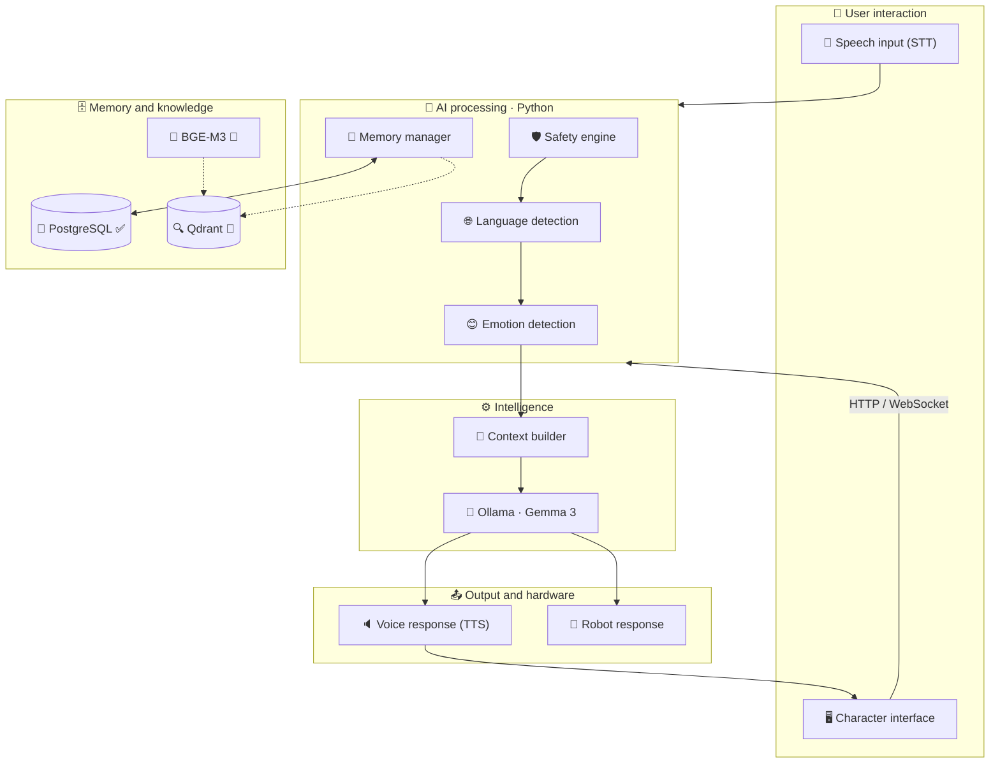

# 🎙️ VOKA AI

### 💙 The AI companion brain of the VIONEX healthcare project

A local, character-based conversational system 🧠 that runs on an AI server and talks with patients through a 🤖 Raspberry Pi head with a 🖥️ display, 🎤 microphone and 🔈 speaker.


**[✨ Features](#-features) · [🏗️ Architecture](#️-architecture) · [📊 Status](#-status) · [🚀 Quick start](#-quick-start) · [🗺️ Roadmap](#️-roadmap) · [👥 Team](#-team)**

</div>

---

## ✨ Features

| | Feature | What it does |
| :-: | --- | --- |
| 💬 | **Conversation** | Understands messages and generates natural replies with a local LLM (🦙 Ollama + Gemma 3) |
| 😊 | **Emotion detection** | 🧠 Transformer-based classifier estimates the emotional context of each message |
| 🛡️ | **Safety engine** | 🚨 Detects crisis situations and can intercept the normal response |
| 🌐 | **Language detection** | 🗣️ Identifies the language of every input |
| 🧠 | **Memory** | 📝 Extracts and stores persistent facts about each user |
| 🔊 | **Voice** | 🎤 Speech-to-text for input, 🔈 text-to-speech for output |
| 📚 | **Knowledge retrieval** *(planned)* | 📄 Answers questions from uploaded PDFs and DOCX files |

---

## 🏗️ Architecture



> 🛡️ Every message passes the **safety check first**. Then the 📝 context builder combines the character's instructions, the current emotion, recent conversation, stored memories and any retrieved knowledge into the prompt.
>
> 🔒 Robot movements are a **separate control path**. The LLM never performs hardware actions directly.

---

## 📊 Status

| Component | Status |
| --- | :-: |
| 🐍 Python core application | ✅ Implemented |
| 🦙 LLM (Ollama + Gemma 3) | ✅ Implemented |
| 🐘 PostgreSQL | 🟢 Existing |
| 🔍 Qdrant vector search | 🚧 Planned |
| 🔢 BGE-M3 embeddings | 🚧 Planned |
| 🧩 Sentence Transformers runtime | 🚧 Planned |

<details>
<summary><b>🔍 Why are retrieval and embeddings still planned?</b></summary>

<br>

🧭 Personal-memory retrieval and 📚 document search both rely on the vector database and the embedding model. Until those are connected, VOKA responds using the live conversation, 😊 emotion, 🛡️ safety and stored facts only.

</details>

---

## 📁 Project structure

<details open>
<summary><b>📂 Show / hide file tree</b></summary>

```text
VOKA/
├── 🚀 app.py                      Main application entry point
├── 🎭 characters.py               Character definitions
├── 😊 emotion_inference.py        Emotion classification at inference time
├── 🧬 model.py                    Model code
├── 🔈 voice_preview.py            Preview of voice output
├── 🖼️ model architecture.png      Model architecture diagram
├── 📐 architecture.txt            Architecture notes
├── 🐳 docker-compose.qdrant.yml   Local Qdrant vector database
├── 📦 requirements.txt            Runtime dependencies
├── 🧪 requirements-dev.txt        Development and test dependencies
├── 🔑 .env.example                Environment variable template
├── ✅ tests/                      Test suite
└── 📦 voka/                       Application package
    ├── 📄 rag/                    Document loading, chunking, embeddings, retrieval
    ├── 🧠 memory/                 Memory extraction and retrieval
    └── 🐘 database/               PostgreSQL access and schema
```

</details>

---

## 🚀 Quick start

<details>
<summary><b>1️⃣ Prerequisites</b></summary>

<br>

- 🐍 Python 3.10 or newer
- 🦙 [Ollama](https://ollama.com) with the Gemma 3 model
- 🐳 Docker, to run Qdrant locally
- 🐘 PostgreSQL, for users, conversations and memories

</details>

<details>
<summary><b>2️⃣ Setup</b></summary>

<br>

```bash
# 1. 📥 Clone
git clone <repository-url>
cd VOKA

# 2. 🐍 Virtual environment and dependencies
python -m venv .venv
source .venv/bin/activate          # Windows: .venv\Scripts\activate
pip install -r requirements.txt

# 3. 🔑 Environment file (fill in the values)
cp .env.example .env

# 4. 🦙 Language model
ollama pull gemma3

# 5. 🐳 Vector database
docker compose -f docker-compose.qdrant.yml up -d

# 6. ▶️ Run
python app.py
```

</details>

<details>
<summary><b>3️⃣ Development and tests</b></summary>

<br>

```bash
pip install -r requirements-dev.txt
pytest
```

</details>

<details>
<summary><b>⚙️ Configuration</b></summary>

<br>

🔧 All settings come from environment variables. [`.env.example`](.env.example) lists every variable the application expects.

> ⚠️ **Never commit your real `.env` file.** It is listed in `.gitignore`. 🙈

</details>

---

## 🗺️ Roadmap

- [ ] 🔗 Connect the vector database and embedding model for meaning-based memory retrieval
- [ ] 📄 Add PDF and DOCX ingestion with knowledge retrieval
- [ ] 🔌 Connect the Raspberry Pi head to the AI server end to end over HTTP or WebSocket
- [ ] 🤖 Integrate VOKA responses with the robot's expressions and hardware commands

---


<div align="center">

🏥 Part of the **VIONEX** project · 💙 Made for safer, kinder care

⭐ *If you like this project, give it a star!* ⭐

</div>
