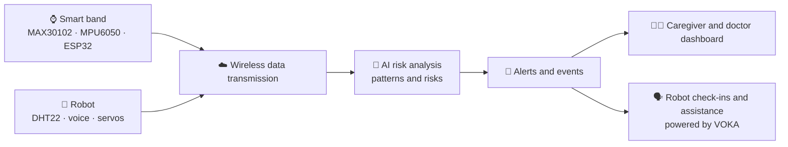
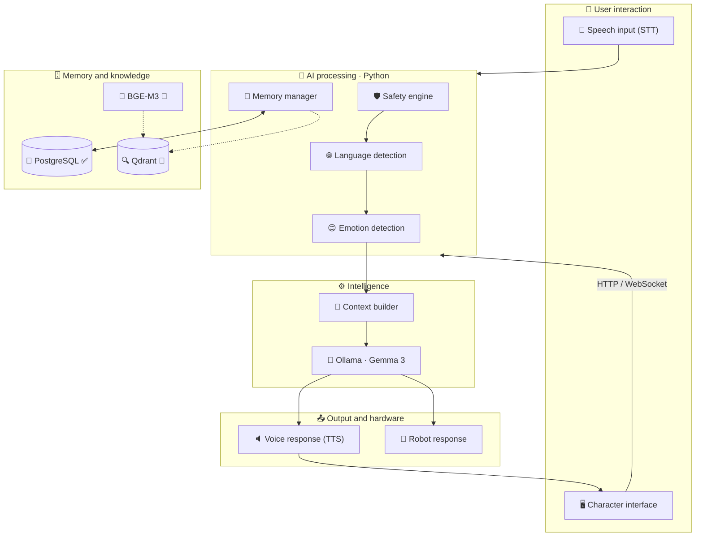

<p align="center">

</p>

<div align="center">

# 🎙️ VOKA AI

### 💙 The conversational AI companion of the VIONEX Personal Health Companion

🧠 A local, character-based AI that talks with patients through a 🤖 humanoid companion robot, checks in on their wellbeing, responds to their emotions, and keeps them safe.


**[📖 About](#-about-voka) · [🎯 Problem](#-the-problem) · [💡 Solution](#-the-solution) · [🧭 Scope](#-what-this-repo-serves) · [✨ Features](#-features) · [🏗️ Architecture](#️-architecture) · [🚀 Quick start](#-quick-start) · [🗺️ Roadmap](#️-roadmap) · [👥 Team](#-team)**

</div>

---

## 📖 About VOKA

**VOKA** is the AI brain of the **VIONEX** Personal Health Companion. It is a local, character-based conversational system that runs on an AI server and speaks with the patient through a **Raspberry Pi head** with a 🖥️ display, 🎤 microphone and 🔈 speaker.

VOKA is built to feel like a caring companion rather than a machine. It understands what the patient says, detects their emotional state, follows safety rules, and remembers what matters to them over time. Its replies are shaped by the character's personality, the recent conversation, stored memories and, when available, relevant knowledge.

> 🩺 VOKA supports patients and caregivers. It is **not** a replacement for medical professionals.

---

## 🎯 The Problem

Healthcare is often **reactive rather than preventive**. Medical attention usually arrives only after a person's condition has already worsened.

- 👵 **Elderly people, patients recovering at home, and people with limited supervision** may not get continuous health monitoring or timely help in an emergency.
- 📉 **Existing health-monitoring devices** mostly collect individual readings. Caregivers often lack one system that shows how a patient's health is changing.
- 🌡️ **Environmental conditions** such as heat and humidity can raise health risks, but they are rarely considered alongside personal health data.

The core gap is the **lack of an integrated, intelligent system** that continuously monitors personal health, understands environmental risks, identifies potential emergencies, and enables timely caregiver intervention.

---

## 💡 The Solution

**VIONEX** is an AI-powered Personal Health Companion. It combines three parts into one healthcare ecosystem:

| | Part | What it does |
| :-: | --- | --- |
| ⌚ | **Smart wearable band** | MAX30102 monitors heart rate and estimates SpO₂. MPU6050 tracks movement and helps identify possible falls. An ESP32 NodeMCU sends the readings wirelessly. |
| 🤖 | **Humanoid companion robot** | Gives voice-based interaction, health reminders, regular check-ins and assistance. A DHT22 sensor tracks room temperature and humidity. |
| 🧠 | **AI-powered analysis** | Combines physiological readings, movement and environmental data to spot unusual patterns, assess risk and generate alerts. |
| 👩‍⚕️ | **Caregiver and doctor dashboard** | Shows health readings, historical trends, environmental conditions, risk indicators and emergency events, so caregivers can monitor patients remotely. |

### 🔄 How it works



🎯 **The goal:** move healthcare from **passive monitoring** to **proactive assistance**. Wearable technology, AI analysis, robotics and remote supervision work together in one system.

---

## 🧭 What This Repo Serves

This repository is the **VOKA AI layer** of VIONEX. It is the part that talks to people.

| ✅ This repo covers | 🔗 Handled elsewhere in VIONEX |
| --- | --- |
| 💬 Conversation and replies | ⌚ Sensor firmware on the ESP32 |
| 😊 Emotion detection on user messages | ☁️ Backend that receives and stores device data |
| 🛡️ Safety checks on every message | 📈 Physiological risk analysis and alert rules |
| 🧠 Persistent memory of user facts | 👩‍⚕️ Caregiver and doctor web portal |
| 🎭 Character personality and voice (STT/TTS) | 🤖 Robot movements and hardware control |
| 📚 Knowledge retrieval *(planned)* | |

🧩 **In short:** VOKA decides *what the companion says and how it responds*. The rest of VIONEX decides *what the sensors measure and when a caregiver is alerted*.

---

## ✨ Features

| | Feature | What it does |
| :-: | --- | --- |
| 💬 | **Conversation** | Understands messages and generates natural replies with a local LLM (🦙 Ollama + Gemma 3) |
| 😊 | **Emotion detection** | 🧠 Transformer-based classifier estimates the emotional context of each message |
| 🛡️ | **Safety engine** | 🚨 Detects crisis situations and can intercept the normal response |
| 🌐 | **Language detection** | 🗣️ Identifies the language of every input |
| 🧠 | **Memory** | 📝 Extracts and stores persistent facts about each user |
| 🔊 | **Voice** | 🎤 Speech-to-text for input, 🔈 text-to-speech for output |
| 📚 | **Knowledge retrieval** *(planned)* | 📄 Answers questions from uploaded PDFs and DOCX files |

---

## 🏗️ Architecture



> 🛡️ Every message passes the **safety check first**. Then the 📝 context builder combines the character's instructions, the current emotion, recent conversation, stored memories and any retrieved knowledge into the prompt.
>
> 🔒 Robot movements are a **separate control path**. The LLM never performs hardware actions directly.

---

## 📊 Status

| Component | Status |
| --- | :-: |
| 🐍 Python core application | ✅ Implemented |
| 🦙 LLM (Ollama + Gemma 3) | ✅ Implemented |
| 🐘 PostgreSQL | 🟢 Existing |
| 🔍 Qdrant vector search | 🚧 Planned |
| 🔢 BGE-M3 embeddings | 🚧 Planned |
| 🧩 Sentence Transformers runtime | 🚧 Planned |

<details>
<summary><b>🔍 Why are retrieval and embeddings still planned?</b></summary>

<br>

🧭 Personal-memory retrieval and 📚 document search both rely on the vector database and the embedding model. Until those are connected, VOKA responds using the live conversation, 😊 emotion, 🛡️ safety and stored facts only.

</details>

---

## 📁 Project structure

<details open>
<summary><b>📂 Show / hide file tree</b></summary>

```text
VOKA/
├── 🚀 app.py                      Main application entry point
├── 🎭 characters.py               Character definitions
├── 😊 emotion_inference.py        Emotion classification at inference time
├── 🧬 model.py                    Model code
├── 🔈 voice_preview.py            Preview of voice output
├── 🖼️ model architecture.png      Model architecture diagram
├── 📐 architecture.txt            Architecture notes
├── 🐳 docker-compose.qdrant.yml   Local Qdrant vector database
├── 📦 requirements.txt            Runtime dependencies
├── 🧪 requirements-dev.txt        Development and test dependencies
├── 🔑 .env.example                Environment variable template
├── ✅ tests/                      Test suite
└── 📦 voka/                       Application package
    ├── 📄 rag/                    Document loading, chunking, embeddings, retrieval
    ├── 🧠 memory/                 Memory extraction and retrieval
    └── 🐘 database/               PostgreSQL access and schema
```

</details>

---

## 🚀 Quick start

<details>
<summary><b>1️⃣ Prerequisites</b></summary>

<br>

- 🐍 Python 3.10 or newer
- 🦙 [Ollama](https://ollama.com) with the Gemma 3 model
- 🐳 Docker, to run Qdrant locally
- 🐘 PostgreSQL, for users, conversations and memories

</details>

<details>
<summary><b>2️⃣ Setup</b></summary>

<br>

```bash
# 1. 📥 Clone
git clone <repository-url>
cd VOKA

# 2. 🐍 Virtual environment and dependencies
python -m venv .venv
source .venv/bin/activate          # Windows: .venv\Scripts\activate
pip install -r requirements.txt

# 3. 🔑 Environment file (fill in the values)
cp .env.example .env

# 4. 🦙 Language model
ollama pull gemma3

# 5. 🐳 Vector database
docker compose -f docker-compose.qdrant.yml up -d

# 6. ▶️ Run
python app.py
```

</details>

<details>
<summary><b>3️⃣ Development and tests</b></summary>

<br>

```bash
pip install -r requirements-dev.txt
pytest
```

</details>

<details>
<summary><b>⚙️ Configuration</b></summary>

<br>

🔧 All settings come from environment variables. [`.env.example`](.env.example) lists every variable the application expects.

> ⚠️ **Never commit your real `.env` file.** It is listed in `.gitignore`. 🙈

</details>

---

## 🗺️ Roadmap

- [ ] 🔗 Connect the vector database and embedding model for meaning-based memory retrieval
- [ ] 📄 Add PDF and DOCX ingestion with knowledge retrieval
- [ ] 🔌 Connect the Raspberry Pi head to the AI server end to end over HTTP or WebSocket
- [ ] 🤖 Integrate VOKA responses with the robot's expressions and hardware commands

---
## Project Link
Web Portal- https://vionex-health-portal.vercel.app/

<div align="center">

🏥 Part of the **VIONEX** Personal Health Companion · 💙 Made for safer, kinder care

⭐ *If you like this project, give it a star!* ⭐

</div>
